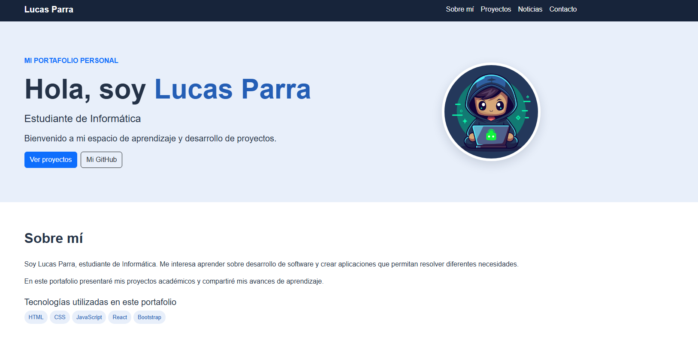
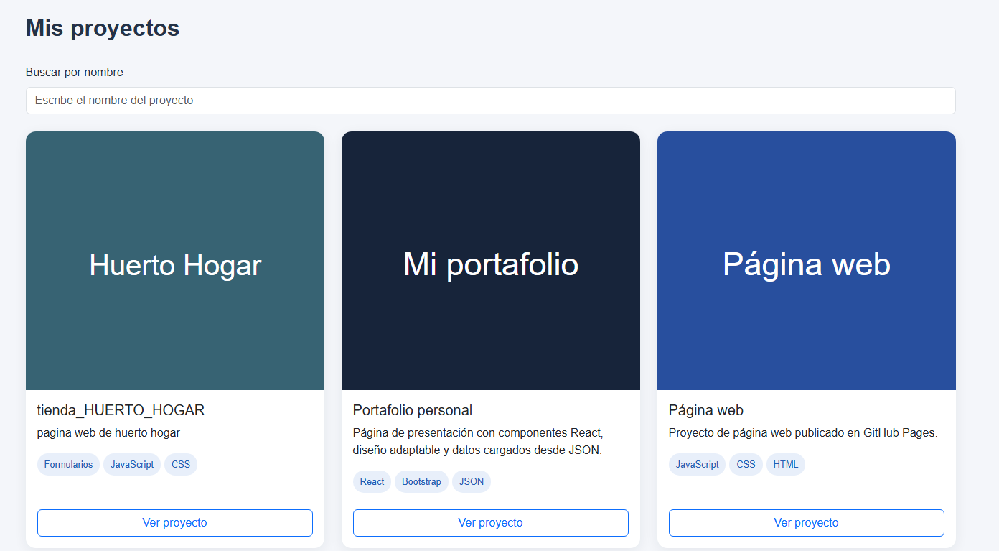

## Portafolio publicado

[Ver mi portafolio](https://lucas-parra29.github.io/formativa/)

# Portafolio de Lucas Parra

Estudiante de Informática · GitHub: https://github.com/lucas-parra29

## Abrir la página

Extrae el ZIP en una carpeta nueva y abre esa carpeta en VS Code. Haz clic derecho en index.html y elige Open with Live Server. Se conserva el puerto 5501. No necesitas npm para abrir la página. La página necesita internet para cargar React, Bootstrap y Babel.

## Archivos necesarios

| Ruta | Función |
|---|---|
| index.html | Entrada de la página |
| css/estilos.css | Diseño |
| js/componentes.js | Componentes React |
| js/app.js | Carga de JSON y montaje |
| data/proyectos.json | Proyectos |
| data/noticias.json | Noticias |
| img/perfil.webp | Imagen de perfil |
| tests/portafolio.spec.js | 30 pruebas Jasmine |
| karma.conf.js | Ejecución y cobertura |
| coverage/informe.txt | Un solo informe de cobertura |
| package.json | Herramientas y comandos |
| package-lock.json | Versiones exactas para instalar |
| .vscode/settings.json | Puerto de Go Live y ocultación de node_modules |
| .gitignore | Evita subir dependencias a Git |
| README.md | Instrucciones, plan y resultados |

## Ejecutar las pruebas

Instala Node.js LTS y un navegador compatible. En PowerShell, dentro de esta carpeta:

```powershell
npm.cmd ci
npm.cmd test
```

npm ci instala las herramientas en node_modules. Esa carpeta es necesaria para ejecutar las pruebas y vuelve a crearse al instalar; VS Code la oculta para no llenar el Explorador. No la edites ni la subas a GitHub.

Para Brave, si Karma no encuentra Chrome, ejecuta esto una vez por terminal:

```powershell
$brave = @(
    "$env:ProgramFiles\BraveSoftware\Brave-Browser\Application\brave.exe"
    "${env:ProgramFiles(x86)}\BraveSoftware\Brave-Browser\Application\brave.exe"
    "$env:LOCALAPPDATA\BraveSoftware\Brave-Browser\Application\brave.exe"
) | Where-Object { Test-Path $_ } | Select-Object -First 1

if ($brave) {
    $env:CHROME_BIN = $brave
    npm.cmd test
} else {
    Write-Host "No se encontró Brave. Revisa su ruta de instalación."
}
```

Si tienes Firefox instalado puedes ejecutar npm.cmd run test:firefox; esa variante no se reporta como ejecutada.

Cada ejecución regenera coverage/informe.txt y muestra el resumen en la terminal. Ya no se generan las carpetas HTML, iconos, hojas de estilo ni archivos LCOV del informe anterior.

## Plan de pruebas

Objetivo: comprobar renderizado, props, cambios de estado, eventos, manipulación del DOM y errores al cargar JSON. Cada caso crea un contenedor propio, sincroniza actualizaciones con React.act y desmonta al terminar. Jasmine restaura sus spies entre casos.

Los mocks de fetch simulan respuestas correctas, espera, red caída, HTTP fallido y JSON inválido sin depender de internet. El fallo de la foto se simula con un evento error.

Los resultados de la tabla corresponden a la ejecución verificada antes de esta limpieza:

| N.º | Comportamiento verificado | Resultado registrado |
|---:|---|---|
| 1 | Muestra el nombre y los cuatro enlaces de navegación | Aprobado |
| 2 | Abre y cierra el menú con su botón | Aprobado |
| 3 | Cierra el menú al elegir una sección | Aprobado |
| 4 | Utiliza las props para nombre, carrera y GitHub | Aprobado |
| 5 | Apunta a la imagen local y tiene texto alternativo | Aprobado |
| 6 | Muestra LP si falla la imagen | Aprobado |
| 7 | Muestra la biografía y las cinco tecnologías | Aprobado |
| 8 | Muestra título, descripción, tecnologías y enlace recibidos | Aprobado |
| 9 | Muestra todos los proyectos antes de buscar | Aprobado |
| 10 | Filtra sin distinguir mayúsculas y elimina espacios extremos | Aprobado |
| 11 | Informa cuando no existen coincidencias | Aprobado |
| 12 | Recupera todos los proyectos al limpiar la búsqueda | Aprobado |
| 13 | Maneja una lista de proyectos vacía | Aprobado |
| 14 | Muestra el título de sección y las noticias sin necesitar fecha | Aprobado |
| 15 | Acepta una sección sin noticias | Aprobado |
| 16 | Incluye etiquetas asociadas a los campos | Aprobado |
| 17 | Rechaza ambos campos vacíos | Aprobado |
| 18 | Rechaza nombre compuesto solamente de espacios | Aprobado |
| 19 | Rechaza mensaje vacío aunque exista nombre | Aprobado |
| 20 | Prepara el mensaje y elimina espacios exteriores | Aprobado |
| 21 | No interpreta el mensaje como HTML ni realiza envíos | Aprobado |
| 22 | Muestra un indicador mientras los datos están pendientes | Aprobado |
| 23 | Solicita los dos JSON y muestra los datos | Aprobado |
| 24 | Separa las noticias por su categoría | Aprobado |
| 25 | Informa una respuesta HTTP fallida | Aprobado |
| 26 | Informa un error de red | Aprobado |
| 27 | Informa JSON mal escrito | Aprobado |
| 28 | Rechaza datos JSON que no sean arreglos | Aprobado |
| 29 | Ignora una respuesta correcta que llega después del desmontaje | Aprobado |
| 30 | Ignora un error de red después del desmontaje | Aprobado |

## Resultados y cobertura

Última ejecución medida incluida: 30 de 30 casos aprobados en Chrome Headless 134 sobre Linux. Se registró también en la conversación una ejecución del usuario con Brave/Chromium 155 sobre Windows, con los mismos porcentajes. Esta edición reorganiza los archivos y el formato del informe; no se afirma una nueva ejecución completa de ella.

| Métrica | Cobertura |
|---|---:|
| Sentencias | 95,23 % |
| Ramas | 96,77 % |
| Funciones | 96,42 % |
| Líneas | 95,16 % |

Los umbrales configurados son 80 % para sentencias, funciones y líneas, y 75 % para ramas. No son mínimos establecidos por la pauta: se definieron para este proyecto. Si se modifican los archivos js, hay que repetir las pruebas para actualizar los resultados. Cobertura alta no significa que la página no tenga fallos.

Las partes de app.js sin cubrir en esa ejecución son el montaje automático en #root y la recarga completa al pulsar Reintentar. Las pruebas montan App en contenedores aislados.

El informe mide JavaScript, no CSS, HTML, datos JSON ni dependencias externas. La revisión visual, el diseño móvil y la disponibilidad de enlaces requieren comprobación manual.

## Cambios de esta limpieza

Se reunieron el plan y los resultados en este README. Se eliminaron LEEME_PRIMERO.txt, docs/ y las copias redundantes del informe. La configuración de cobertura reconoce rutas Windows y Linux. Se redujeron líneas en blanco sobrantes en el código; se conservaron los datos, la imagen, el diseño y los componentes del usuario.

## Antes de entregar

El contenido actual conserva dos proyectos, una ilustración como foto y noticias sin fecha. La pauta pide tres proyectos, fotografía profesional y fecha en las noticias. Faltan además publicación en GitHub Pages, historial Git y capturas del portafolio en este README. No se modificaron esas decisiones de contenido.

## Capturas del portafolio

### Inicio


### Proyectos


## Ejemplos de uso

- Navegación: presionar los enlaces del menú para ir a cada sección.
- Buscador: escribir “Huerto” para filtrar los proyectos y borrar el texto para verlos todos.
- Proyectos: presionar el botón de una tarjeta para abrir su enlace.
- Formulario: completar el nombre y el mensaje para ver la confirmación. Es una demostración y no envía mensajes.